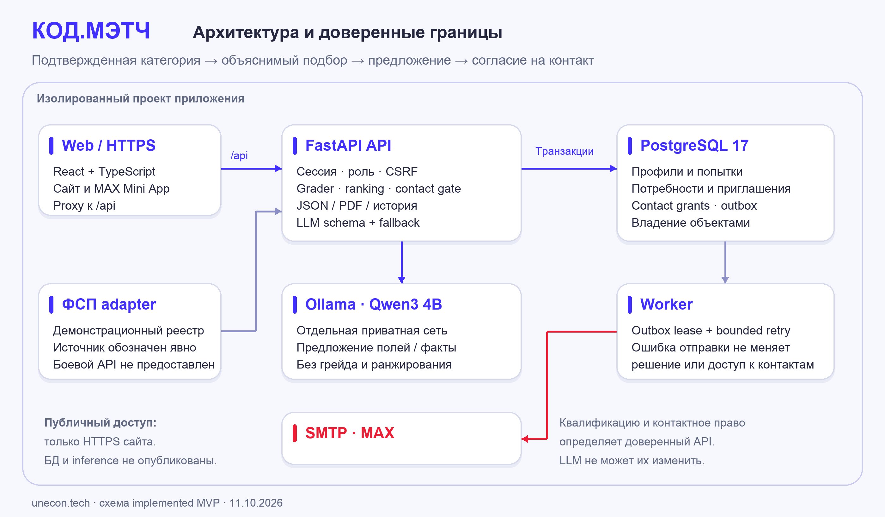

# КОД.МЭТЧ – описание решения и техническая документация

Редакция документов **11.10.2026**. Даты отдельных проверок указаны в отчете. Платформа: [fsp.digital-projects.tech](https://fsp.digital-projects.tech). Бот: [КОД.МЭТЧ в MAX](https://max.ru/se14505142_1_bot). Поддержка: [codematch@mail.ru](mailto:codematch@mail.ru).

КОД.МЭТЧ соединяет подтверждение навыков с инициативой работодателя: кандидат проходит тест и получает категорию, компания описывает потребность и направляет адресное предложение с зарплатной вилкой. Контакты кандидата открываются конкретной компании после принятого приглашения либо самостоятельного отклика на ее вакансию. Для основного сценария публиковать вакансию не требуется.

Документ описывает продукт, архитектуру, алгоритмы, запуск, действия для проверки и фактически выполненные offline/live-проверки. Исторический приемочный релиз **0.1.0-20261007T204413Z** связан с архивом из 155 файлов; результаты реальных учетных записей приведены в разделе 11. Исторический объем проверки указан в разделе 11; свежая приемка 11 октября и актуальный релиз – в разделе 15. Наличие инструкции, готового профиля или HTTPS не заменяет отдельное доказательство конкретного сценария.

## 1. Доступ и подготовка проверки

Для основного сценария нужны отдельные учетные записи с ролями **«Кандидат»** и **«Работодатель»**. Готовые доступы для проверки владелец передает приватно; эта инструкция не содержит паролей, токенов и личных email. Можно зарегистрировать собственные адреса и проверить настоящую почтовую цепочку. Категория готового демонстрационного профиля не считается экзаменом, пройденным проверяющим: для проверки теста используйте учетную запись без попытки соответствующей категории.

Откройте роли в **разных профилях браузера или разных браузерах**. Несколько обычных вкладок одного профиля разделяют сессию. Если в другой вкладке выполнен вход работодателем, прежняя вкладка кандидата тоже может перейти на эту активную учетную запись. Перед действиями сверяйте подпись роли в левом меню. Квалификационный тест доступен кандидату; работодатель не должен видеть форму кандидата или получать право ее сохранить. Защита server-side остается обязательной.

Для проверки изоляции контактов дополнительно полезна вторая отдельная компания. Она должна смотреть тот же кандидатский профиль без собственного принятого приглашения или отклика. Для отдельных сценариев принятия и отказа используйте разные сочетания «потребность + кандидат»: повторная отправка того же приглашения не создает новую независимую историю.

На узком экране меню открывается кнопкой в верхнем левом углу. Для смены пользователя нажмите **«Выйти»** внизу меню, затем войдите в нужную роль.

## 2. Кандидат: профиль → тест → подтвержденная категория

### Профиль

1. Откройте **«Мой профиль»**. Заполните имя, профессиональный заголовок, специализацию, предполагаемый уровень, навыки, стаж, роли, soft skills, город, формат работы и зарплатные ожидания.
2. Заполните собственные контакты и выберите видимость профессионального профиля в банке. Нажмите **«Сохранить профиль»**. Настройка видимости и разрешение конкретной компании на контакты – разные действия.
3. Дополнительный путь: **«Заполнить из PDF-резюме»**, текстовый PDF до 5 МБ → предпросмотр → **«Перенести в форму»** → проверка и редактирование → **«Сохранить профиль»**. Скан без текстового слоя может не распознаться. Импорт и изменение резюме не присваивают подтвержденный уровень.
4. Скачайте собственный **«Профиль в PDF»**. Проверьте русский текст, поля и актуальную категорию. PDF работодателя должен применять разрешение контактов этой компании отдельно от собственного PDF кандидата.

### Первичный тест

1. Откройте **«Подтвердить уровень»**. В блоке **«Профессиональная анкета»** выберите специализацию и предполагаемый Junior или Middle, укажите отрасль, ранее решенные и желательные задачи. Нажмите **«Сохранить анкету»**.
2. Нажмите **«Начать тест»**. До сохранения анкеты старт недоступен. В начатой попытке должны появиться задания выбранной специализации и уровня, условия проверки и время.
3. Решите задания самостоятельно. Выбор патча/варианта и JSON-трассировка проверяются сервером. В SQL-заданиях вводится read-only SELECT-запрос к данным задания. Незаполненный или неправильный ответ может дать ноль; частичные баллы определяются рубрикой.
4. Нажмите **«Завершить и получить результат»**. Сверьте сумму, результаты компетенций, решение о подтверждении уровня и запись в **«Ваши попытки»**.
5. Вернитесь в **«Мой профиль»**: предполагаемый уровень и подтвержденная категория отображаются отдельно. Работодатель получает подтвержденную категорию только по успешному результату теста. Стаж, самозаявленный стек, достижения ФСП и LLM не заменяют первичный тест.

| Категория | Формат ограниченной практической проверки |
|---|---|
| Python · Backend / Junior | Анализ кода, патч, трасса, выбор решений |
| Python · Backend / Middle | Анализ более сложных случаев, патч, трасса, компетентностные блоки |
| TypeScript · Frontend / Junior | Анализ показанного кода, патч и JSON-трасса |
| TypeScript · Frontend / Middle | Анализ более сложных случаев, патч, трасса и выбор решений |
| Data · SQL / Junior | Read-only SQL, анализ результата и выбор корректного подхода |
| Data · SQL / Middle | Read-only SQL с более сложными агрегациями и проверкой граничных случаев |

Каждая категория содержит **5 заданий / 100 баллов**. Junior подтверждается при сумме **не менее 65**, Middle – **не менее 75**; дополнительно требуется **не менее 50% каждого измеренного компетентностного блока**. Поэтому высокая общая сумма сама по себе не гарантирует прохождение.

На попытку отведено **45 минут**. Повтор той же специализации и уровня ограничен **90 днями**, в том числе после завершения или истечения попытки. Кандидат может добровольно выбрать другой уровень. Неудачный Middle не понижает ранее подтвержденный Junior. Интервал 90 дней – решение команды; для research test–retest применяется отдельный offline-валидатор, production-история не сбрасывается.

Для незавершенной попытки доступно продолжение: после обновления страницы откройте активную попытку из списка. Текущий интерфейс восстанавливает черновик из sessionStorage для той же учетной записи/попытки в той же браузерной сессии; таймер сохраняет серверный срок и не начинается заново. Это фактически проверено reload-сценарием. Закрытие сессии браузера, другое устройство или запрет storage могут удалить локальный черновик, поэтому полного межустройственного сохранения ответов не обещаем. Не используйте ответы из технического исходника для демонстрации независимой проверки способностей. Production-история и 90-дневное ограничение при тестировании не стираются.

## 3. Работодатель: компания → потребность → подбор

1. Войдите работодателем и откройте **«Компания»**. Укажите название, описание, направление деятельности, сайт и способ связи. Нажмите **«Сохранить компанию»**. Заполненная анкета не означает внешнюю юридическую проверку компании.
2. Откройте **«Подбор кандидатов»** → **«Новая потребность»**. Для сквозной проверки выберите ту же специализацию и подтвержденный уровень, которые кандидат получил в разделе 2.
3. Опишите задачу команды, обязательные и желательные навыки, город/формат работы и зарплатный диапазон **от–до в рублях**. Условия нужно согласовать с профилем кандидата. Для первой пробы не требуйте навыков, которые выбранный тест не измерял.
4. Нажмите **«Сохранить и подобрать»**. Проверьте список, категорию, подтвержденные навыки, индекс и раскрывающийся блок **«Почему в подборе»**. Отсутствие подходящих кандидатов при жестких ограничениях – допустимый результат; он не должен заполняться заведомо неподходящими людьми.
5. Нажмите **«Профиль»**. До собственного разрешенного события у компании должны быть **«Контакты скрыты»**: email/телефон/контактные ссылки кандидата отсутствуют. ФИО и названия прошлых работодателей допускаются официальным ответом ФСП; они не дают права показать контактные данные.
6. Добавьте кандидата закладкой и проверьте **«Короткий список»**. Удаление закладки не отзывает выданное ранее разрешение контактов.
7. Уточните фильтры/выберите сохраненную потребность и проверьте сохранение исходной подборки и истории. Режим **«Весь банк»** показывает видимые профили с фильтрами; для приглашения выберите **«Потребность для приглашения»**. Предполагаемый неподтвержденный уровень не должен называться подтвержденной категорией.

### Как формируется индекс

Версия алгоритма: **matching-1.0.0**. Сначала действуют условия допуска: видимый профиль, подходящая специализация, достаточный подтвержденный уровень, отсутствие известных проваленных обязательных навыков, совместимые указанные зарплата/формат/город. Внутренняя валидационная политика `require_verified_skills` исключает неизвестное покрытие; отдельного UI/API-переключателя этой политики в MVP нет. Отсутствующая информация не превращается автоматически в доказанное соответствие.

Далее индекс правил состоит из **60 баллов за покрытие обязательных навыков, 10 за желательные, 25 за результат теста и до 5 за релевантную историю ФСП**. История ФСП не компенсирует неизвестный обязательный навык и не заменяет подтверждение категории. Отсутствие ФСП не штрафует кандидата. Этот индекс – объяснимое правило ранжирования, **не вероятность успешного найма**.

## 4. Главный сценарий: адресное приглашение и контакты

В первом проходе у кандидата не должно быть прежнего разрешения компании A. Профиль оставьте видимым, чтобы сравнивать доступ к контактам, а не скрытие всего профиля.

1. Компания A нажимает **«Пригласить»** в подборе, заполняет описание предложения, зарплатную вилку и собственный способ связи, затем **«Отправить приглашение»**. Публикация вакансии для этого не нужна.
2. Кандидат открывает **«Приглашения»** → **«Посмотреть условия и контакт»**. Название компании, предложение, диапазон RUB и связь работодателя видны до начала общения. Просмотр может сменить статус на **«Просмотрено»**, контакты кандидата остаются скрыты.
3. Кандидат нажимает **«Принять и открыть контакты»**. Компания A обновляет **«Приглашения»**, проверяет **«Принято»** и **«Посмотреть профиль и доступные контакты»**. Теперь разрешенные контакты этого кандидата доступны этой компании.
4. Компания B открывает того же кандидата без собственного принятия/отклика. Контакты остаются скрыты. Принятие предложения A не открывает данные всем работодателям.
5. Компания A скачивает актуальный **«Профиль в PDF»** и сверяет контакты. Новый PDF компании B не должен их содержать.
6. Кандидат открывает **«Настройки»** → **«Доступ к вашим контактам»**, проверяет компанию A, основание и дату разрешения. **«Отозвать доступ»** закрывает дальнейшую выдачу контактов A.
7. Компания A закрывает прежнюю карточку, обновляет страницу и скачивает **новый** PDF. Контакты снова скрыты. Ранее скачанный файл не изменяется и не удаляется с чужого устройства.

Для отказа выберите свежую потребность/кандидата без старого разрешения этой компании. Кандидат открывает предложение и нажимает **«Отклонить»**. Оба кабинета показывают отказ; отказ сам по себе не открывает контакты. Если компания уже имела разрешение через другое событие, отказ нового предложения его не отзывает.

Повторное приглашение того же сочетания «потребность + кандидат» не должно дублировать запись. Уже принятое предложение не превращается в отказ. Скрытие профиля из общего банка, удаление закладки и закрытие вакансии не являются отзывом контактного разрешения. Кабинет может требовать обновления раздела; мгновенный push всех окон не заявляется.

## 5. MAX: связь с кабинетом и доставка

В продукте используется **только MAX**. Web-кабинет работает самостоятельно. MAX добавляет запуск мини-приложения, связь с тем же подтвержденным аккаунтом и уведомления.

1. Откройте [бота проекта](https://max.ru/se14505142_1_bot), нажмите **«Начать»** либо отправьте `/start`. Проверьте ответ и кнопку открытия КОД.МЭТЧ.
2. В подтвержденном web-аккаунте откройте **«Настройки»** → **«MAX»** → **«Подключить»**. Выполните показанное действие `/start <одноразовый код>` из собственного MAX. Код не пересылайте другому человеку и не публикуйте.
3. Вернитесь в настройки и нажмите **«Проверить статус еще раз»**. Должна появиться связь именно с текущим аккаунтом. `/status` показывает состояние/роль привязанного аккаунта без раскрытия его email.
4. Откройте мини-приложение кнопкой бота. Проверьте правильную роль, меню, профиль и возможность открыть приглашения. Обычный открытый в браузере `/mini/max` URL не доказывает подписанный запуск внутри MAX.
5. Повторите приглашение из раздела 4. Кандидат сверяет фактически полученное MAX-уведомление и запись в кабинете. Уведомление не должно содержать приватные контакты кандидата.
6. Примите либо отклоните предложение в кабинете и проверьте статус у работодателя. Если MAX привязан у работодателя, дополнительно сверяйте его уведомление об ответе. Наличие события в web-кабинете не равнозначно доставке MAX-сообщения.

Команды бота: `/start` и `/help` – подсказка/кнопка; `/status` – состояние привязки; `/start <код>` – одноразовая привязка; `/unlink` – отключение. `/unlink` используйте после основного прохода, чтобы проверить отключение и повторную привязку. Отключение отменяет ожидающие будущие сообщения, но не гарантирует отзыв сообщения, уже переданного транспортному провайдеру. Частые команды ограничены сервером.

Для одновременного приема уведомлений разными ролями нужны разные MAX-идентичности: одну идентичность нельзя незаметно связать с чужой учетной записью. Это проверка авторизации, а не обязательная квота внешних добровольцев. Подготовленные web-профили не создают настоящие MAX-аккаунты. Статус полной native-приемки фиксируется отдельно в разделе 11.

## 6. Где используется локальная LLM

Модель **Qwen3 4B Instruct 2507 Q4_K_M** работает через Ollama в отдельном приватном серверном проекте. Веб-API обращается к ней через приватную сеть, inference не опубликован на внешнем порту. Установка модели одобрена владельцем; приложение не скачивает веса автоматически.

Модель помогает работодателю:

- **«Разобрать описание»** – предлагает редактируемые структурированные поля из текста потребности. Пользователь подтверждает их перед сохранением.
- **«Пояснить подбор»** – выбирает и упорядочивает уже рассчитанные проверенные факты. Отображаемые предложения формируются сервером из доверенных шаблонов; обязательные оговорки сохраняются.

Модель не оценивает квалификационный экзамен, не присваивает подтвержденный грейд, не рассчитывает индекс и не меняет порядок кандидатов. При текущем **`LLM_PERSONAL_DATA_ALLOWED=false`** PDF-резюме разбирается локально без отправки модели. Пояснение использует разрешенные факты без ФИО/email/идентификаторов кандидата и ответов теста. В свободный текст потребности не включайте личные данные: автоматическое скрытие контактов/ссылок не распознает все возможные имена и персональные сведения.

### Проверка двух AI-действий

1. В работодателе откройте **«Подбор кандидатов»** → **«Новая потребность»** → **«Помочь разобрать свободное описание»**. Введите:

   > Ищем Python-разработчика Junior для API. Обязательные навыки: Python и SQL. Желательный навык: Docker. Удаленная работа. Зарплата от 80 000 до 120 000 рублей в месяц.

2. Нажмите **«Разобрать описание»**, сверяйте предложенные специализацию/уровень/навыки/формат/вилку. **«AI-разбор»** означает принятый сервером ответ модели; **«Локальный разбор»** – резервный механизм. Нажмите **«Перенести поля и проверить»**, отредактируйте при необходимости и только затем **«Сохранить и подобрать»**.
3. В профиле кандидата из подборки нажмите **«Пояснить подбор»**. **«AI-пояснение по фактам»** означает успешный принятый вызов; **«Сохраненное пояснение»** – кэш; **«Пояснение по правилам подбора»** – резервный вариант.
4. Сравните индекс, категорию и порядок до/после: они не меняются. Проверьте факты навыков, результата теста, условия зарплаты и явные пробелы доказательств.

Ресурсный режим: один одновременный inference, общий бюджет **20 AI-действий в час на работодателя**, deadline модели **до 35 секунд**. Эти параметры – выбор команды, не официальные аппаратные лимиты конкурса. При недоступности/таймауте LLM обычный подбор и безопасное пояснение продолжают работать. Один успешный inference не доказывает p95 или производительность параллельных AI-запросов.

## 7. Почта и обычные учетные записи

Для настоящей почтовой проверки используйте адрес, к которому у проверяющего есть доступ. Готовый заранее подтвержденный профиль не проверяет доставку письма.

1. На главной нажмите **«Создать профиль»**, выберите роль, укажите email и пароль длиной не менее 12 символов, прочтите условия и подтвердите согласие. Нажмите **«Создать учетную запись»**.
2. Откройте полученное письмо КОД.МЭТЧ. На странице по ссылке нажмите **«Подтвердить email»**; один переход по ссылке не заменяет подтверждение. Войдите в выбранную роль.
3. При необходимости заполните Email на форме входа/регистрации и нажмите **«Отправить письмо подтверждения еще раз»**. Ответ намеренно не раскрывает состояние чужой учетной записи и не подтверждает доставку. Срок ссылки – 24 часа; новая ссылка делает прежнюю неиспользованную недействительной.
4. После основного прохода проверьте **«Забыли пароль?»** → свое письмо → новый пароль → повторный вход. Ссылка действует час и одноразовая. Изменение пароля завершает прежние сессии.
5. В письме и на странице подтверждения должно быть название **КОД.МЭТЧ**, поддержка – **codematch@mail.ru**. Адрес поддержки остается прежним: изменение бренда не создает автоматически новый mailbox.

Получение SMTP-сервером сообщения и его появление в реальном inbox – разные доказательства. Ошибку доставки фиксируйте по конкретному действию/времени, без публикации токена из ссылки. Многократные повторные запросы ограничиваются сервером. Проверка безопасности почтового провайдера может быть внешней причиной отказа; приложение должно корректно обработать ее и восстановить доставку, но не может гарантировать отсутствие будущих блокировок провайдера.

## 8. ФСП, оформление и дополнительные сценарии

### ФСП без боевого API

Профиль допускает связь с ID участника ФСП. Боевой API/схема/эталонный dataset организатором не предоставлены, поэтому используется отдельный adapter с демонстрационным реестром и описанным будущим контрактом. Вручную введенный ID сам по себе не является внешним подтверждением личности или достижений. У доказательства показываются источник/статус; учебная запись не выдается за настоящую медаль.

Проверьте полный путь **без FSP ID и истории**: профиль → тест → категория → подбор → приглашение → решение/контакты. Отсутствие истории ФСП не блокирует регистрацию и не является штрафом. Keycloak – ориентир будущей совместимости, не обязательный вход текущего MVP.

### Контекст брендбука

В новой визуальной редакции использован предоставленный фирменный материал ФСП: неизмененные SVG-версии логотипа для соответствующего фона, отдельное охранное пространство, фирменные паттерны и локальные шрифты. Основная палитра на странице 8 – **#402FFF / #EC1D35 / #EDEDED** и нейтральные серые; **#0A006B** – дополнительный цвет цифровой среды, используемый для глубины интерфейса. JetBrains Mono – основная типографика, TDAText – акцентная; материалы флагманских проектов также содержат Inter. Цвета/шрифты презентационного шаблона ЛЦТ не следует смешивать с веб-брендбуком.

Собственный прозрачный симметричный знак КОД.МЭТЧ остается знаком продукта, официальный логотип ФСП – обозначением контекста спецтрека. Оформление не должно создавать впечатление, что платформа является официальной системой Федерации. Глубина/свет/движение дополняют интерфейс: текст, контраст, фокус и основные действия должны оставаться читаемыми; при `prefers-reduced-motion` движение ограничивается. В разделе 11 приведен фактически проверенный объем desktop/mobile/MAX; полная WCAG-сертификация и проверка всех физических устройств не заявляются.

### Необязательные для MVP, но реализованные пути

| Путь | Как проверить | Ожидаемый результат |
|---|---|---|
| Вакансии | Работодатель: **«Вакансии компании»** → создать/редактировать/опубликовать; кандидат: **«Вакансии»** | Видна опубликованная вакансия с RUB-вилкой, черновик не попадает в общий список |
| Самостоятельный отклик | **«Посмотреть и откликнуться»**, сообщение и явное согласие → отправка | Статусы в **«Мои отклики»/«Отклики»**, контакт доступен только компании этой вакансии |
| Закрытие вакансии | Закрыть собственную проверочную вакансию | Она исчезает из открытого каталога, история сохраняется |
| Короткая задача | Работодатель: **«Короткие задачи»** → создать; кандидат: **«Практика»** → решение | Проверка ответа/история/результат владельца задачи; основная квалификационная категория не повышается автоматически |
| Уведомления/история | Колокольчик, отметить прочитанным, история обеих ролей | События согласуются с выполненными действиями; web-событие не называется transport receipt |
| Жалоба | **«Настройки»** → конкретный объект и описание проблемы | Сохраняется обращение; это не внешняя юридическая экспертиза |

ATS и защита от фиктивных работодателей описаны как концепции/контракты будущего развития. Действующая интеграция с коммерческой ATS и фактическая юридическая проверка всех компаний не заявляются. Безопасность проверяется содержательными функциональными отрицательными сценариями; независимая сертификация безопасности не заявляется.

## 9. Проведенная offline-валидация

Дата результатов: **07.10.2026**. Исходники domain assessment/matching/validation связаны SHA256, production и настоящие аккаунты этим исследованием не изменялись. Сеть отключена в валидаторе, LLM не использовалась. Проверки выполнены реальным доверенным grader, а контрольные ответные политики построены технически из серверного oracle. Это **авторская синтетическая groundtruth**, не независимая человеческая оценка навыков.

### Альтернативные формы и test–retest

- **6 категорий × 20 содержательно разных вариантов = 120 форм** с одинаковым blueprint, числом заданий и весами внутри категории.
- **360 основных** оценок weak/borderline/strong и **360 дополнительных** проверок границ/провала компетенции; все **720** повторены тем же grader.
- **180** парных сравнений основных политик на альтернативных формах: совпадение pass/fail **100%**, средняя абсолютная разница баллов **0**.
- **120** независимых сравнений Python-агрегации и SQL-эталона технических fixtures.
- **78 проверок, 0 неудачных**. Публичная проекция задания не раскрывает oracle/закрытые эталоны.

| Контролируемая политика | Балл | Junior | Middle |
|---|---:|---|---|
| Все ответы неверные | 0 | Не подтвержден | Не подтвержден |
| Пограничная основная | 66.67 | Подтвержден | Не подтвержден |
| Ниже порога Middle | 73.33 | Подтвержден | Не подтвержден |
| Выше порога Middle | 80 | Подтвержден | Подтвержден |
| Полный правильный ответ | 100 | Подтвержден | Подтвержден |
| 80 суммарно, но провален отдельный блок | 80 | Не подтвержден | Не подтвержден |

Эти политики показывают работу рубрики/порогов и повторяемость формального checker. Они не означают, что реальный Junior/реальный Middle автоматически разделяются с такой точностью. На постоянных рядах Pearson/kappa неопределены; отчет сохраняет `null`, а не подставляет 1.0. Эмпирическая психометрическая равноценность сложности на людях не установлена.

Перенос дословного полного ответа формы A на другие свежие формы: **114 проб, 0 проходов** на выбранных seeds. Исторический отдельный эксперимент дал **1 проход из 72** и сохраняется как ограничение. Конечные семейства, понимание стратегии, SQL-шаблон, помощь человека/LLM и утечка целого семейства остаются рисками. Абсолютный античит и IRT-калибровка не заявляются.

### Подбор на эталонной разметке команды

Набор: **40 авторских синтетических профилей × 12 потребностей = 480 relevance labels**; 6 development и 6 holdout запросов. Метки 0/1/2 заданы отдельно от scorer. Автор меток не является независимым HR-экспертом, внешняя проверка не проведена. Текущий пересчет совпал с прежними frozen результатами.

| Метод | Development P@5 / nDCG@5 / critical mismatch | Holdout P@5 / nDCG@5 / critical mismatch |
|---|---|---|
| Доказательный подбор | 1.0000 / 0.9854 / 0 | 0.3333 / 1.0000 / 0 |
| Базовый поиск по ключевым словам | 0.6667 / 0.5574 / 10 | 0.2333 / 0.3794 / 23 |
| Без ФСП-бонуса | 1.0000 / 0.9838 / 0 | 0.3333 / 1.0000 / 0 |
| Без подтвержденного тестового evidence | 0.8000 / 0.8251 / 6 | 0.2667 / 0.9106 / 10 |

**P@5** всегда делится на 5: короткая точная выдача не маскируется новой формулой. Holdout nDCG=1.0 рассчитан по **5 запросам с положительными gold**; один no-positive запрос исключен только из nDCG, но остается в P@5. Precision-of-returned 1.0 – другая метрика. Critical mismatch – число нарушений жестких требований в top5 на выбранном наборе, не все возможные ошибки найма.

Holdout авторский и малый, не внешний слепой HR-набор. Метрики не доказывают качество трудоустройства, универсальную переносимость на рынок или отсутствие ошибок на закрытом наборе жюри. Основной продуктовый путь проверяется дополнительно живыми кабинетами из разделов 2–7.

### Воспроизведение и артефакты

Методика и машиночитаемые результаты входят в папку `evidence/` финального комплекта. Offline-валидатор расположен в `source/research/jury-validation-20261007/` и выполняет проверки доменным grader без сети, пользователей и production-БД; относительные пути сохраняются в исходном пакете. Закрытые эталоны остаются серверной частью исходников, а не ответами в инструкции кандидата.

Из корня исходного пакета, в подготовленном Python 3.12 окружении:

```bash
PYTHONDONTWRITEBYTECODE=1 fsp-match/.venv/bin/python research/jury-validation-20261007/run_validation.py
```

Этот запуск записывает собственный research JSON, не меняет результаты тестов на публичном стенде. Полный пересчет связан с хэшами трех доменных файлов и manifest релиза. Он не заменяет сквозную проверку кабинетов, почты и MAX.

## 10. Соответствие официальным требованиям

Обозначения источников: **S:n** – физическая страница исходного ТЗ; **X:Bn** – ячейка ответа на листе `Лист1` файла «Ответы на вопросы трек ФСП ЛЦТ__.xlsx»; **C:n** – строка оригинальной переписки; **Q:n** – предоставленный конспект видеовстречи. Письменный ответ организатора имеет приоритет перед вторичным конспектом.

| Что проверять | Официальное основание |
|---|---|
| Обратная инициатива работодателя, категория по тесту, прямое предложение | S:2–5, §2/2.1/2.2 |
| Подтверждение email, закрытые контакты, обязательная RUB-вилка и статусы | S:5, §2.2 |
| Ручной профиль либо PDF-импорт, стандартизированный PDF, путь без ФСП | S:3–4 |
| Вариативность, объективная проверка, стабильность/разделение/эталон | S:2–3/8; X:B4/B9/B13 |
| Грейд – навыки, а не стаж; ФСП не заменяет тест | X:B1/B5/B13 |
| Одна категория достаточна; 2 специализации × 2 грейда достаточно для MVP | X:B6/B12/B16/B17; здесь реализованы 3×2 |
| Синтетическая процедура команды допускается, минимум внешних людей не установлен | S:3/8; X:B4. Q:167 – дополнительное пояснение конспекта |
| Зарубежные cloud LLM разрешены; локальная открытая Qwen допустима | X:B7; ПДн и риски передачи описывает команда |
| Нет жесткой квоты веса модели/RAM; скорость – приемлемое время | X:B10/B11 |
| Вакансии/отклики, короткие задачи, mobile, ATS/антифейк концепция – дополнительные возможности | S:4–5/8; X:B2/B14 |
| MAX – выбранное командой дополнение | ТЗ требует web-сервис; мессенджер не заменяет два кабинета |
| Читаемые исходники, презентация, DOC/PDF-документация и проверяемый доступ | S:6–8; отсутствие deployment компенсируется видео и локальной инструкцией |
| Слайды 7–11 сохранить по дизайну и структуре шаблона | C:210–211/850–854/1205–1209 |
| Выступление 10 мин, видео допустимо, стенд желательно держать весь период оценки | X:B3 |

Главные критерии оценки: **подбор 35%, тестирование/валидация 25%, UI 10%, техническая проработка 7%, полнота/документация 6%, дополнения 7%, финальная презентация 10%**. Поэтому сначала проверяется рабочая цепочка category → matching → invitation → contact, затем дополнительные визуальные/AI/MAX возможности.

Дедлайн первой сдачи: **11.10.2026, 23:59 МСК**. Подписанное положение ОД-306/26 и актуальная форма организатора определяют допуск/порядок отправки. Самостоятельная публикация конфиденциального ТЗ, переписки, секретов и закрытых персональных данных не требуется для читаемого исходника. Public/invited доступ к репозиторию и actual поля/размеры финальной загрузки проверяются отдельно. Питч назначен на 24.10 онлайн.

## 11. Историческая живая приемка 7–8 октября и ее границы

**LIVE_ACCEPTANCE_STATUS: VERIFIED_SCOPED**

**FINAL_LIVE_CHECK_AT_UTC:** `2026-10-07T20:58:10.965475+00:00`

**FINAL_RELEASE:** `20261007T204413Z`  
**FINAL_VERSION:** `0.1.0-20261007T204413Z`  
**DEPLOYMENT_ARCHIVE_FILES:** 155  
**DEPLOYMENT_ARCHIVE_SHA256:** `751fd69179ca15e5a04643be7a746f201887fb1ca8daaa2730f694fdf0e69c44`

Новый комплект документации хранится отдельно от этого deployment archive и от прежних frozen документов. Final package audit подтвердил все 155 source hashes, bounded secret check и связь offline-validation с доменными исходниками. Публичный/runtime и серверный readback 7–8 октября завершены; их исторические результаты указаны ниже. Выполненные ниже сценарии не означают, что презентация, публикация репозитория или конкурсная отправка уже выполнены.

### Учетные записи и сценарии

Использованы **две обычные подтвержденные учетные записи кандидата и одна работодателя**, предоставленные владельцем для проверки. Их email/пароли/личные идентификаторы здесь не публикуются. Прохождение выполнялось как техническая приемка реального интерфейса/API; оно не является независимым экзаменом способностей этих людей.

| Сценарий | Фактический статус | Доказанный объем и ограничение |
|---|---|---|
| Подтвержденные обычные аккаунты и вход | Проверено в указанном объеме | Два кандидата и один работодатель email-verified, доступны правильные кабинеты. Независимое получение нового письма в inbox этим фактом не доказано |
| GUI первичного теста | Проверено в указанном объеме | Кандидат A: Python / Junior, 100; кандидат B: SQL / Junior, 100. Сохранены результаты/категории, 90-дневное cooldown сохранен. Это два технических GUI-прохода, не human-validation всех 6 категорий |
| Timer/draft reload | Проверено в указанном объеме | Незавершенная попытка/серверный остаток времени восстановлены; сохраненные ответы возвращены в той же браузерной сессии. Другие устройства/полный restart не обещаны |
| Shared-session и прямой employer#assessment | PASS | После смены роли обе вкладки согласуются; employer-адрес квалификации переводится на home с понятным сообщением; candidate-форма отсутствует. Server-side403 не ослаблен |
| Компания/потребность/подбор/закладки | Проверено: API | Реальные бизнес-сценарии через API: квалифицированная выдача, сохранение short list, собственные истории. Девять employer-страниц отдельно проверены в UI без сообщений об ошибке/старого бренда |
| Приглашение/решение/replay | Проверено: API | Адресные предложения, принятие/отказ и идемпотентный повтор решения; согласованные статусы. Это business/API proof, не доказательство всех native transport receipts |
| Контакты и PDF | Проверено: API | JSON/PDF закрыты до разрешенного события; соответствующее разрешение открывает данные; отзыв закрывает новые JSON/PDF; чужая роль/посторонний доступ не получают контакты |
| Вакансия и самостоятельный отклик | Проверено: API | Непубликуемая → опубликованная → собственный отклик → снята с публикации. История/идемпотентность/контактные правила проверены |
| Адресная короткая задача | Проверено: API | Создана для собственного проверяемого кандидата, результат 100; основная категория не меняется, ожидаемый ответ не опубликован. Проверено 0 получателей вне разрешенной аудитории |
| MAX команды и привязка | Проверено: MAX web | Реальный web-клиент MAX: `/status`, `/help`, `/unlink`, одноразовый `/start` повторно восстановили привязку кандидата A |
| Подписанный MAX WebApp | Проверено: MAX web | Внутри клиента открыты настройки, home и приглашения; правильная роль/подпись запуска, iframe 388. Это один проверенный native web-клиент, не все версии телефонных приложений |
| MAX уведомления о бизнес-действиях | Кандидат проверен; две роли отдельно | Приглашение и короткая задача получены собственным кандидатом в реальном MAX web-клиенте: оба PASS; server outbox показывает 6 MAX delivered. Ответ работодателю в MAX, вторая native identity и телефонные клиенты отдельно не проверены |
| Новая LLM: actual model | Проверено в указанном объеме | `llm_structured` разбор 26.05 с, `llm_grounded` пояснение 4.767 с; 7 checks: подтверждение полей, отсутствие скрытой мутации, cache, неизменное ранжирование и contact gate. Это две измеренные latency, не p95/параллельная capacity |
| SMTP нового бренда | Принято SMTP | Mail.ru принял 6 email-сообщений, outbox отмечен delivered, failed/retry 0; бренд отправителя/тем обновлен. Независимый inbox receipt не доказан и не объявляется PASS |
| Локальные regression/security проверки | Проверено в указанном объеме | Исторически 185 PASS, 3 dedicated PostgreSQL SKIP; отдельно 92 rebrand-focused и 70 salary-focused PASS. Свежие local и dedicated PostgreSQL результаты – в разделе 15. Наборы могут пересекаться, их не суммируют как независимые проверки. Frontend 12 checks и production build PASS. Внешняя DAST-сертификация не заявляется |
| Источники и brand context | Проверено: исследование | Все 6 письменных входов разобраны полностью. Brand-пакет: 189 файлов прочитаны, 235 страниц визуально просмотрены, 16 продуктовых brand assets совпали побайтно. Не означает отдельную лицензию публикации всех оригиналов |
| Современный дизайн/геометрия | Проверено в указанном объеме | Desktop, mobile 375/320 и MAX iframe 388 проверены; фирменные логотипы/паттерн/типографика и КОД.МЭТЧ. Не полная WCAG-сертификация и не все физические устройства |
| Страницы кандидата и импорт PDF | Проверено: UI | Восемь страниц загружены без ошибок/старого бренда/горизонтального overflow при ширине 1176. UI PDF preview требует ручного подтверждения, cancel не сохраняет профиль. Обзор, приглашения, вакансии, отклики, практика, история, квалификация и настройки проверены |
| HTTPS/runtime/source и прежние проекты | Проверено: runtime и сохранность | На 20:58:10 UTC все 6 проверенных public URLs дали 200, HTTP→HTTPS 301, TLS 1.3, сертификат до 04.01.2027. PublishedJS/CSS совпали побайтно с final local build ; 7 API sourceSHA, включая 3 domain, равны final manifest. Все 63 контейнера учтены, 11 ранее работающих продолжают работать; 60 защищенных byte-facts неизменны, изменены только собственные api/web/worker |

### Завершающая сверка данных и эксплуатации

После приемки временные изменения имени, заголовка, описания, зарплаты и формата работы двух реальных кандидатских профилей возвращены к исходным значениям. Выбранные подтвержденные категории **Python Junior / SQL Junior**, настоящие результаты и 90-дневные попытки сохранены. Пароли, прежние grants, MAX-связи и исходная visibility=false не сбрасывались. Новые технические contact grants отозваны; собственная проверочная вакансия снята с публикации. Техническая компания, потребности и история сохранены как следы проверенного сценария, не как реальные предложения от третьих лиц. Два финальных PDF проверены с новым брендом.

Уведомление, созданное для собственной технической проверки, отмечено прочитанным через UI. Обратная связь сохранена на собственном техническом объекте без внешней отправки и без обвинения реальной компании. Mobile-кабинет 375 px имеет scrollWidth 375, именованный навигационный dialog, рабочее закрытие; Escape закрывает меню и возвращает фокус. Это конкретные UI-проверки, не декларация универсальной доступности.

Срез ресурсов хоста при итоговой проверке: **32 логических CPU**, MemTotal 32 617 361 408 байт, available 30 112 305 152 байт, disk available 157 396 553 728 байт, load1≈0.271. Это текущие измерения общего хоста, не выделенная гарантия ресурсов каждому будущему пользователю. Существующие БД, Ollama и чужие проекты входят в защищенную сверку.

Артефакты завершающей приемки в рабочем наборе: `research/jury-acceptance-20261007/runtime-final.json`, `server-preservation.json`, `candidate-pages-ui.json`, `resume-import-ui.json`, `owner-final-readback.json`, `final-package-audit.json`. Они не публикуются автоматически вместе с приватными данными; документ содержит только разрешенные агрегаты.

### Отдельно непроведенное

- Независимый human/HR-пилот и психометрическая калибровка не проведены. Они рекомендованы как продолжение, не являются дополнительным официальным минимумом людей для сдачи.
- Самостоятельное независимое получение шести новых писем в конечных inbox не установлено; известно acceptance Mail.ru и delivered outbox.
- MAX-приглашение и короткая задача получены одним собственным кандидатом в web-клиенте; непроведенными остаются MAX-ответ работодателю, walkthrough второй native identity и телефонных клиентов, физический телефонный PDF и все screen-reader среды.
- Дополнительная запись конференции длительностью 55:47 не транскрибирована полностью. Официальные письменные ТЗ/ответы/переписка прочитаны целиком; вторичный конспект не переименован в полный просмотр видеозаписи.
- Три dedicated PostgreSQL regression checks пропущены в нынешнем локальном прогоне; прежние доказательства PG/restore не переименованы в новые результаты.

Offline-исследование раздела 9 имеет отдельные domain SHA на 07.10.2026. Финальный package audit подтвердил совпадение этих доменных путей с final source. Новая документация не изменяет исторические v1.1/v1.2 и не приписывает им нынешние результаты.

Если обнаружена ошибка, укажите сценарий/роль/время/ожидаемое и фактическое поведение и обратитесь в поддержку **codematch@mail.ru**. Пароль, token из письма, одноразовый код MAX и приватные контакты в публичный отчет не включаются.

## 12. Архитектура и доверенные границы



Сервис использует React/TypeScript с Vite на клиенте, FastAPI/Pydantic/SQLAlchemy на сервере и PostgreSQL 17 для production-данных. SQLite применяется только для локальных функциональных проверок и одноразовых ограниченных SQL-задач. Вход, роли, квалификация, ранжирование и доступ к контактам проверяются API; фронтенд не является источником прав.

| Компонент | Назначение и граница |
|---|---|
| Web и внешний HTTPS proxy | Статические assets, маршрутизация `/api`, TLS. Только входной web-порт публикуется через выделенный vhost |
| API | Сессия, CSRF, роль/владение объектом, доверенный grader, подбор, PDF, бизнес-транзакции |
| PostgreSQL | Пользователи, профили, attempts, evidence, потребности, решения, contact grants, история, outbox |
| Worker | Ограниченная фоновая доставка почты и MAX с повтором, lease и санитарной записью ошибки |
| Ollama / Qwen3 | Отдельный локальный приватный inference для редактируемого разбора потребности и пояснения по фактам |
| ФСП adapter | Явно ограниченный реестр демонстрационных записей; заменяемый контракт будущего API |

Изолированный Compose-проект приложения содержит `db/api/worker/web`, собственную сеть и volume. У Ollama отдельный проект и приватная сеть; API подключен к ней, worker не подключен. В исходниках отсутствуют ключи, production `.env`, копии БД и личные доступы. Публичные веса модели не упакованы в исходники; приложение не загружает их самопроизвольно.

Основные сущности связаны следующим образом: учетная запись определяет роль; кандидат владеет профилем и попытками; успешная попытка создает skill evidence и подтвержденную категорию. Работодатель владеет компанией, потребностями и приглашениями. Contact grant связывает конкретного кандидата и конкретную компанию; разрешение не становится общим для всех компаний. Отдельные события истории и outbox сохраняются вместе с изменением делового состояния.

### Тестирование как доверенное вычисление

Вариант строится сервером из blueprint и seed. Публичная форма содержит задания, критерии и открытые данные; oracle и закрытые fixtures в проекцию кандидата не входят. Клиент отправляет ограниченный объект ответов. Python/TypeScript проверяют рассуждение, выбранный патч и JSON-трассу; произвольный пользовательский Python/JS не исполняется. SQL исполняется в временной SQLite с read-only authorizer, ограничениями текста, строк/размера результата и времени.

Баллы складываются по рубрике, проверяются общий порог и минимум каждой компетенции. Результат и категория фиксируются транзакционно. Идемпотентная повторная отправка не создает другую оценку; параллельный старт и чужая попытка не обходят владение. PostgreSQL использует блокировки строк; локальная SQLite – сериализацию изменения состояния. Серверный срок попытки остается источником времени.

### Формула подбора

Сначала исключаются несовместимые профили: скрытый профиль, другая специализация, недостаточный подтвержденный уровень, явный провал обязательного навыка, несовместимая известная зарплата, формат или место работы. Строгая политика `require_verified_skills` применяется в доменной валидации и исключает неизвестный обязательный навык; отдельного UI/API-переключателя в MVP нет. Неизвестность зарплаты/формата не подменяется подтверждением: пояснение сообщает пробел.

После фильтров вычисляется **индекс правил от 0 до 100**:

```text
score = 60 × покрытие обязательных навыков
      + 10 × покрытие желательных навыков
      + 25 × (балл первичного теста / 100)
      + бонус ФСП (0 или 5)
```

Покрытие считается только по подтвержденному evidence. При отсутствии соответствующего списка навыков его компонент равен полному весу; желательные навыки исключают уже перечисленные обязательные. Бонус 5 возможен только для подходящего подтвержденного источника достижений и при отсутствии пробела обязательного evidence. Достижения не компенсируют отсутствующий тест, недостаточный грейд или жесткое несоответствие. Равные индексы упорядочиваются стабильно по ID. Индекс не является вероятностью найма; версии формулы и компонент доступны в объяснении.

### Контакты, PDF и уведомления

Принятие приглашения и явный самостоятельный отклик создают разрешение контактов только своей компании. Просмотр, отказ, закладка, сообщение короткой задачи и участие в тесте такого права не дают. Отзыв разрешения закрывает последующие JSON/PDF-проекции; уже законно сохраненную внешнюю копию сервис отозвать не может. PDF формируется с тем же company gate, что JSON.

Уведомления доставляются отдельно от бизнес-транзакции: ошибка SMTP/MAX не меняет решение и не открывает контакты. Outbox реализует доставку как минимум один раз, с lease, bounded retry и не более 8 попыток; авария после фактической отправки до записи результата может повторить уведомление. Отправки не следует называть exactly-once. В MAX notification нет приватных контактов. Отвязка отменяет ожидающую доставку по прежней связи; уже отправленное сообщение нельзя отозвать.

### Защита и ограничения

| Механизм | Что защищает | Практическая граница |
|---|---|---|
| HttpOnly/Secure сессия и CSRF/Origin | Подмена браузерного действия, кража cookie через обычный JavaScript | Требует HTTPS и доверенного browser environment |
| Проверка роли и владельца объекта | Чужие попытки, потребности, решения, PDF, grants | Проверяется на сервере, скрытие кнопки недостаточно |
| SQL rate limiter | Повторы входа, писем и AI-запросов | Может намеренно отклонять слишком быстрый тестовый сценарий |
| Одноразовые mail/link tokens | Повтор подтверждения/сброса/привязки | Восстановление отменяет старые сессии; значения не публикуются |
| Подписанный MAX launch + freshness | Подложный запуск Mini App | Сначала email-verified web-аккаунт и одноразовая привязка |
| PDF ≤5 MiB /30 страниц, отдельный interpreter | Неконтролируемая обработка импортированного файла | Скан без текста и сложная верстка могут не распознаться |
| Structured LLM schema и fallback | Неправильный JSON, prompt injection в объяснение | Свободный текст не гарантирует распознавание любых ПДн |

MAX – единственный активный мессенджер. Поддержка внешней ATS и юридическая верификация компаний описаны как концепции дальнейшего развития, а не действующие внешние проверки. Полная сертификация безопасности, независимая WCAG-аудитория и психометрическая калибровка в этом MVP не заявляются.

## 13. Запуск исходников и API

### Локальный изолированный запуск

Для контейнерного запуска нужны Docker Compose и Python 3 для локального инициализатора параметров. В образах используются Python 3.12 и Node.js 22; установка Node.js 22 на хост нужна только для отдельной npm-ветки разработки/проверки. Backend-зависимости зафиксированы в `backend/requirements.lock`, frontend – в `frontend/package-lock.json`. Выполняйте команды из папки `source/fsp-match` распакованного комплекта. Создайте собственные приватные параметры: инициализатор не перезаписывает существующие значения.

1. Выполните `python3 scripts/init_runtime.py` в новом отдельном локальном каталоге.
2. В созданном локальном `.secrets/runtime.env` задайте собственные имена и предварительно свободные порты:

```dotenv
FSP_COMPOSE_PROJECT=kodmatch-jury-local
FSP_NETWORK_NAME=kodmatch-jury-local-private
FSP_VOLUME_NAME=kodmatch-jury-local-postgres
FSP_PORT=18094
FSP_MAILPIT_PORT=18025
SEED_DEMO=false
```

3. В локальном `.secrets/integrations.env` укажите **только для development** `LEGAL_OPERATOR_NAME=Локальная проверка прототипа` и `LEGAL_OPERATOR_CONTACT=demo@example.org`. Это подписи изолированного стенда, а не реквизиты настоящего production оператора. Внешние токены оставьте пустыми; dev overlay отключает внешние мессенджеры и отправляет почту в Mailpit.
4. Проверьте конфигурацию без печати секретов и запустите отдельный экземпляр:

```bash
docker compose --env-file .secrets/runtime.env --env-file .secrets/integrations.env -f compose.yaml -f compose.dev.yaml config --quiet
docker compose --env-file .secrets/runtime.env --env-file .secrets/integrations.env -f compose.yaml -f compose.dev.yaml up -d --build --wait
```

5. Откройте `http://localhost:18094`, тестовую почту – `http://localhost:18025`. Создайте две роли с тестовыми адресами, откройте письмо в Mailpit и явно подтвердите email на странице приложения. Выполните основной сценарий. Письма не отправляются внешним получателям. Для повторного независимого прогона создайте новые QA-аккаунты или выберите другую категорию; попытки/результаты вручную не сбрасывать.

На машине с существующими проектами сначала проверьте занятость портов. Одного `-p` недостаточно: имена сети и volume также задаются конфигурацией. Остановка собственного локального экземпляра – та же команда Compose с `stop`, без удаления volume. Подробная инструкция находится в `source/fsp-match/README.md`. Полная новая чистая Docker-установка этим описанием не объявляется выполненной.

Production использует `compose.yaml`, HTTPS, собственного оператора, действительный SMTP sender и отдельный проверенный proxy. Без настроенного оператора/почты обычная регистрация не должна объявляться работающей. Пример шаблона параметров – `config/integrations.env.example`, без значений. Собственные production доступы, БД и email-пароли не требуются для offline проверки исходников.

Для локальной разработки без Docker используйте отдельный `.venv` и инструкции `backend/README.md`: `scripts/run_local.py api`, отдельный `scripts/run_local.py worker` и `npm run dev` из frontend. Worker требует SMTP; один API-процесс сам по себе не доказывает доставку. Синтетический seed включается только явно, не подменяет настоящую регистрацию и не перезаписывает существующие аккаунты.

### Проверки исходника

```bash
PYTHONPATH=backend .venv/bin/python -m pytest backend/tests -q
cd frontend
npm ci
node --test tests/navigation-assessment.test.mjs
npm run build
```

`npm ci` и установка backend lock требуют подходящей среды/доступа к registry; результаты прежнего окружения не объявляются новым clean-room запуском. PostgreSQL concurrency проверки требуют отдельной тестовой БД через `FSP_TEST_DATABASE_URL`; они используют собственную случайную схему. Не указывайте production БД. Отсутствие отдельной БД дает SKIP, а не PASS. Полный набор воспроизводимых команд и актуальный receipt находятся в исходном пакете и `evidence/`. Переносимый локальный запуск описан в `source/fsp-match/README.md`; связь копии исходника с production-релизом фиксирует `source/source-manifest.json`.

### Обзор API

Публичная точка – `/api`; OpenAPI: [openapi.json](https://fsp.digital-projects.tech/api/openapi.json). Интерактивная страница API отключена в production. Сначала `GET /api/auth/me` создает pre-auth cookie и возвращает CSRF; каждый browser mutation передает `X-CSRF-Token`, cookie и разрешенный Origin.

| Группа | Основные маршруты |
|---|---|
| Почта и вход | `/auth/register`, `/auth/confirm-email`, `/auth/login`, `/auth/logout`, `/auth/resend-confirmation`, `/auth/forgot-password`, `/auth/reset-password` |
| Кандидат | `/candidate/profile`, `/candidate/profile/import`, `/candidate/profile/pdf`, `/candidate/survey`, `/candidate/attempts`, `/candidate/history`, `/candidate/contact-grants` |
| Компания и подбор | `/employer/company`, `/employer/needs`, `/employer/needs/parse`, `/employer/needs/{id}/search`, `/employer/shortlist`, `/employer/candidates`, `/candidates/{id}/pdf` |
| Предложение | `/employer/invitations`, `/candidate/invitations`, `/candidate/invitations/{id}/view`, `/candidate/invitations/{id}/respond` |
| Дополнения | `/vacancies`, `/candidate/vacancies/{id}/respond`, `/microtasks`, `/candidate/microtasks/{id}/submit`, `/notifications`, `/feedback/report` |
| MAX | `/integrations/status`, `/integrations/messenger/link-code`, подписанный messenger launch/webhook |
| Диагностика | `/health`, `/ready`, `/version` |

В API-контракте исходников приведены методы, схемы, лимиты и идемпотентность. Создание приглашения требует собственную потребность, кандидата, сообщение, контакт работодателя и положительную RUB-вилку, `salary_max ≥ salary_min`. Зарплата показана за месяц до вычета НДФЛ. Значения реальных mail/link tokens отсутствуют в API пользователя и в публичных журналах.

## 14. Команда, эксплуатация и границы дальнейшего развития

Команда **unecon.tech**: **Черевко Валерий Евгеньевич** – капитан, совместная разработка, продукт и техническая поддержка; **Бережных Михаил Алексеевич** – совместная разработка, интерфейсы и дизайн. Оператор и первичный контакт поддержки: Черевко Валерий Евгеньевич, [codematch@mail.ru](mailto:codematch@mail.ru). Реквизиты и правила обработки данных доступны в разделе [«Обработка данных»](https://fsp.digital-projects.tech/privacy). Контакт участника команды: mikhailber@list.ru. Первичная техническая поддержка – codematch@mail.ru; личные проверочные адреса не публикуются.

В production используется отдельный проект на российском сервере; inference выполняется локально без обязательного зарубежного сервера или Яндекс Облака. Предыдущая живая проверка включала резерв перед изменением и сопоставление чужих сервисов. Это срез состояния на указанную дату, не обещание непрерывного uptime без мониторинга. Стенд должен оставаться доступным весь период оценки; для временной внешней недоступности полезны локальная инструкция и резервное видео.

Дальнейшее развитие: боевой FSP adapter после получения контракта и доступа, внешняя ATS, расширение заданий/специализаций, независимая HR-разметка и человеческая психометрическая калибровка, юридическая проверка работодателя и фактический пилот найма. Эти возможности не включаются в показатели уже выполненного MVP. Документированное ограничение не должно подменяться неподтвержденным обещанием.

## 15. Итоговая проверка и актуальный комплект, 11 октября

Актуальный серверный релиз: **0.1.0-20261011T104017Z**. SHA256 deployment archive: `c66ed8fbb0b2b54e5c24f20e1b0e2bbf9f6288f1cb2f17f597be293d6bbda949`. Публичный адрес: [fsp.digital-projects.tech](https://fsp.digital-projects.tech). Исходники: [GitHub unecon.tech / КОД.МЭТЧ](https://github.com/Valery766/kodmatch-lct-2026); репозиторий подготовлен **приватным**, открытие доступа жюри выполняет владелец отдельно. Читаемая копия кода уже входит в `source/` архива.

| Проверка 11.10.2026 | Фактическое доказательство | Граница |
|---|---|---|
| Source copy /backend/frontend | 186 backend PASS, 3 PostgreSQL SKIP; 12 frontend regression PASS; Python compile 46 файлов; offline 78 checks /0 failures | Повтор в отдельной копии с существующими зависимостями; не новая clean dependency installation |
| PostgreSQL concurrency | Отдельный запуск: **3 PASS /0 SKIP**, восемь параллельных стартов, повтор submit и параллельное принятие/контакты | Выделенная тестовая БД и случайные тестовые схемы; production квалификация не сбрасывалась |
| Резерв и восстановление | Фактический dump собственной БД восстановлен в отдельную БД; число строк и SHA всех 23 таблиц совпали | Снимок сделан 11.10 до нового GUI-теста; это не запуск восстановления поверх production |
| Публичный runtime | Шесть основных URL 200, HTTP→HTTPS 301, trusted TLS 1.3; опубликованные JS/CSS совпали с локальным build; семь backend paths совпали с release manifest | Датированный readback 2026-10-11T10:45:01.744510+00:00; не гарантия будущего uptime |
| Реальный новый кандидат через UI | Подтвержденный аккаунт участника: сохранена анкета, Python Junior 100/100, draft пережил reload, категория/попытка/cooldown сохранены | Техническая приемка команды по публично показанным заданиям, не независимый экзамен способностей человека |
| Работодатель и команда | Подтвержденный login, подборка видна, logout; новые роль и email Михаила проверены в публичном footer | Отдельные бизнес-сценарии прежнего полного прохода остаются датированными 7–8 октября |
| Четыре реальных аккаунта | 3 кандидата и 1 работодатель: ordinary/email-verified, собственные профили/PDF с текущим брендом, RBAC 403 /anonymous 401, logout; 32 проверки прошли | Read-only/API и проверка конкретных разрешенных аккаунтов; не новые человеческие экзамены всех шести категорий |
| Локальная LLM | Actual structured parse 29.154 с; grounded explanation 5.884 с; детерминированный индекс 97 сохранен, подтверждение полей обязательно | Два измерения конкретного вызова; не p95 и не тест максимальной одновременной нагрузки |
| Почта и MAX-связи | SMTP SSL 465 AUTH 235 за 0.42 с; две учетные записи имеют действующую MAX-связь | Новых писем не отправляли; повторное получение внешним inbox и physical-phone delivery этим срезом не доказаны |
| Сервисы | Обновлены только собственные api/web/worker; собственные PostgreSQL и Ollama сохранены, все прежде работавшие контейнеры продолжают running | В общем интервале чужие Wolfe сервисы менялись параллельно вне этого обновления; глобальная неизменность хоста не заявляется |

Локальные 3 PostgreSQL SKIP и отдельные серверные 3 PASS – разные контексты исполнения. Не складывайте пересекающиеся focused-наборы как новые независимые тесты. Функциональные негативные сценарии проверяют auth/CSRF/RBAC/IDOR, таймер/черновик, идемпотентность, contact/PDF privacy и fallback; внешняя сертификация не заявляется.

Фактический ресурсный срез: 32 логических CPU, память всего 32.62 млрд байт, доступно 26.95 млрд байт, диск свободен 113.01 млрд байт, load1≈4.12. Это состояние общего хоста в момент измерения; пределы контейнера модели 8 CPU /8 GiB и один inference сохраняются отдельно. Публичный inference порт не появляется.

Ссылки на безопасные результаты: `evidence/runtime-final.json`, `evidence/postgres-and-restore-final.json`, `evidence/gui-acceptance.json`, `evidence/live-account-results.json`, `evidence/source-test-results.json`; итоговый manifest связывает их с готовыми документами, презентацией и копией исходников. Исходники, документы и презентация находятся в отдельных папках, закрытое ТЗ/переписка и operational handoff в отправляемый ZIP не включены.

Дополнения сохраняют честную границу: боевой ФСП adapter/ATS, independent HR/human психометрика, полная WCAG-сертификация и все физические MAX/телефонные PDF клиенты не заявлены. Фактическое получение recovery-письма в настоящем inbox подтверждается отдельно, SMTP acceptance его не заменяет. Эти записи не создают выдуманный официальный минимум внешних добровольцев и не скрывают непроверенный шаг. Финальный отчет папки `evidence/` имеет приоритет для конкретного live-сценария.
