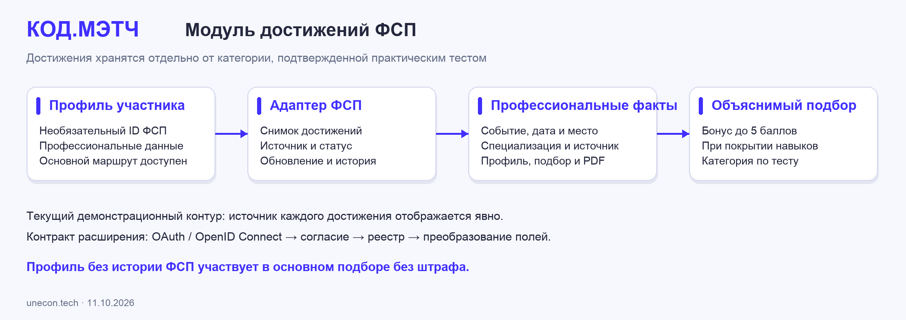

# КОД.МЭТЧ – описание решения и техническая документация

Финальная редакция **11.10.2026**. Команда **unecon.tech**.

[Открыть платформу](https://fsp.digital-projects.tech) · [Бот КОД.МЭТЧ в MAX](https://max.ru/se14505142_1_bot) · [Техническая поддержка](mailto:codematch@mail.ru).

КОД.МЭТЧ – платформа обратного подбора ИТ-специалистов по подтвержденным навыкам. Кандидат проходит практический тест и получает квалификационную категорию. Работодатель описывает задачу, получает объяснимый список подходящих специалистов и направляет персональное предложение с зарплатной вилкой. Кандидат видит условия, принимает решение и самостоятельно разрешает раскрытие своих контактов конкретной компании.

Основной сценарий работает без обязательной публикации вакансии и без истории участия в ФСП. Дополнительно доступны вакансии и отклики, короткие практические задачи, импорт и экспорт PDF, уведомления в MAX и локальный языковой помощник.

Команда провела итоговую проверку на нескольких реальных подтвержденных учетных записях. Черевко Валерий Евгеньевич и Бережных Михаил Алексеевич лично подтвердили работу пользовательских сценариев, бота MAX и получения писем. Результаты автоматизированных проверок приведены в разделе 11.

## 1. Доступ и начало работы

Для знакомства с платформой откройте [fsp.digital-projects.tech](https://fsp.digital-projects.tech). Зарегистрируйте две учетные записи: **«Кандидат»** и **«Работодатель»**. Используйте два адреса электронной почты, к которым у вас есть доступ. Пароль должен содержать не менее 12 символов. После регистрации откройте письмо КОД.МЭТЧ, перейдите по ссылке и нажмите **«Подтвердить email»**.

Для одновременной работы в двух ролях используйте разные браузеры или разные профили браузера. Обычные вкладки одного профиля используют общую сессию. Название текущей роли показано в меню. Квалификационные тесты доступны в кабинете кандидата, а создание потребностей и подбор – в кабинете работодателя.

На узком экране меню открывается кнопкой в верхнем левом углу. Кнопка **«Выйти»** находится внизу меню. Для проверки первичного теста выберите учетную запись без попытки соответствующей специализации и уровня: правила повторного прохождения сохраняются для каждого пользователя.

Техническая поддержка: **codematch@mail.ru**. Пошаговый маршрут знакомства с платформой приведен в отдельном документе **«КОД.МЭТЧ – инструкция для жюри»**.

## 2. Кандидат: профиль, тест и подтвержденная категория

### Профессиональный профиль

В разделе **«Мой профиль»** кандидат указывает имя, профессиональный заголовок, описание, навыки, специализацию, предполагаемый уровень, опыт, профессиональные роли, личные качества, город, формат работы и зарплатные ожидания. Контактные данные хранятся отдельно от публичной профессиональной информации. Пользователь самостоятельно выбирает видимость профиля в банке специалистов.

Профиль можно заполнить вручную или импортировать из текстового PDF-резюме: **«Заполнить из PDF-резюме»** → загрузка → предпросмотр → **«Перенести в форму»** → редактирование → **«Сохранить профиль»**. Импорт поддерживает файлы до **5 МиБ** и **30 страниц**. Сначала пользователь проверяет извлеченные поля, затем сохраняет их. Исходный файл после обработки не сохраняется.

Кнопка **«Профиль в PDF»** создает стандартизированный документ с актуальными данными и подтвержденной категорией. Собственный PDF кандидата содержит его контакты; PDF для работодателя формируется с учетом разрешения этой компании.

### Практическое подтверждение навыков

1. Откройте **«Подтвердить уровень»** и заполните **«Профессиональную анкету»**: специализация, предполагаемый уровень, интересующая отрасль, уже решенные и желаемые задачи.
2. Нажмите **«Сохранить анкету»**, затем **«Начать тест»**.
3. Выполните пять заданий выбранной категории. Для Python и TypeScript применяются анализ кода, выбор исправления и трассировка. Для SQL – запросы на чтение, агрегации и анализ результата.
4. Нажмите **«Завершить и получить результат»**. Система показывает общий балл, результаты по компетенциям и решение о подтверждении уровня.
5. В **«Мой профиль»** появится подтвержденная категория, а в **«Ваши попытки»** сохранится результат.

| Специализация | Уровни | Проверяемые навыки |
|---|---|---|
| Python · Backend | Junior и Middle | Анализ кода, исправление ошибок, трассировка, выбор технического решения |
| TypeScript · Frontend | Junior и Middle | Анализ поведения кода, исправление, JSON-трассировка, граничные случаи |
| Data · SQL | Junior и Middle | Запросы на чтение, агрегации, анализ результата, обработка граничных случаев |

### Параметры теста

Каждый вариант содержит **5 заданий** общей стоимостью **100 баллов**. Для Junior требуется **не менее 65 баллов**, для Middle – **не менее 75 баллов**. Дополнительно результат каждого измеряемого компетентностного блока должен составить **не менее 50%**. Это позволяет подтверждать именно совокупность необходимых навыков.

Продолжительность попытки – **45 минут**. Повтор той же специализации и уровня доступен через **90 дней**. Кандидат может выбрать другой уровень; неудачная попытка Middle сохраняет ранее подтвержденный Junior. Сервер хранит время, вариант и результат попытки. При обновлении страницы черновик ответов восстанавливается в той же браузерной сессии.

Предполагаемый и подтвержденный уровни показаны отдельно. Категорию присваивает серверная проверка теста. Изменение резюме, стаж, достижения ФСП и языковая модель сохраняют свою отдельную роль в профиле и подборе.

## 3. Работодатель: компания, потребность и объяснимый подбор

В разделе **«Компания»** работодатель заполняет название, описание, направление деятельности и способ связи. Затем в **«Подбор кандидатов»** создает потребность: специализация, уровень, обязательные и желательные навыки, формат и место работы, описание задачи и зарплатная вилка в рублях за месяц до вычета НДФЛ.

После **«Сохранить и подобрать»** система показывает подходящих кандидатов. В карточке доступны подтвержденная категория, результаты компетенций, совпавшие навыки, параметры предложения и причины соответствия. Кнопка **«Профиль»** открывает подробности; закладка добавляет кандидата в **«Короткий список»**. Созданные потребности сохраняются в истории поиска.

Подбор начинается с обязательных условий: видимость профиля, специализация, подтвержденный уровень, необходимые навыки и совместимость известных условий работы. Затем вычисляется индекс от **0 до 100**:

```text
Индекс = 60 × покрытие обязательных навыков
       + 10 × покрытие желательных навыков
       + 25 × (балл первичного теста / 100)
       + бонус достижений ФСП (0 или 5)
```

Индекс отражает соответствие заданным правилам и позволяет сравнивать кандидатов в рамках конкретной потребности. Компоненты расчета доступны в пояснении. История ФСП учитывается при полном покрытии обязательных навыков. Специалист без истории ФСП проходит тот же основной маршрут и получает подбор без штрафа за отсутствие достижений.

## 4. Персональное приглашение и управление контактами

1. Работодатель нажимает **«Пригласить»**, указывает описание предложения, зарплатную вилку и свой способ связи, затем отправляет приглашение.
2. Кандидат открывает **«Приглашения»** → **«Посмотреть условия и контакт»**. Название компании и все условия доступны до начала общения. Статус меняется на **«Просмотрено»**.
3. Кандидат выбирает **«Принять и открыть контакты»** или **«Отклонить»**. Решение отображается в обоих кабинетах.
4. При принятии контакты становятся доступны только компании, отправившей предложение. Ее актуальный PDF также содержит разрешенные данные. Остальные работодатели продолжают видеть профессиональную информацию без контактов.
5. В **«Настройки»** → **«Доступ к вашим контактам»** кандидат видит компанию, основание и дату разрешения. Кнопка **«Отозвать доступ»** закрывает последующую выдачу контактов в интерфейсе и новых PDF.

Просмотр предложения, закладка и отказ сохраняют контакты закрытыми. Самостоятельный отклик на вакансию с явным согласием открывает их компании этой вакансии. Скрытие профиля в общем банке и разрешение контактов конкретной компании – отдельные настройки.

Повтор отправки приглашения для той же пары «потребность + кандидат» возвращает существующую запись. Принятое решение сохраняется согласованно в обоих кабинетах. Уже скачанный PDF является внешней копией: отзыв доступа действует на дальнейшее получение данных.

## 5. MAX: бот, мини-приложение и уведомления

MAX связан с тем же подтвержденным аккаунтом и той же историей действий. Бот открывает мини-приложение и доставляет уведомления о приглашениях, ответах и коротких задачах.

1. Откройте [КОД.МЭТЧ в MAX](https://max.ru/se14505142_1_bot), нажмите **«Начать»** или отправьте `/start`.
2. На сайте в подтвержденном аккаунте откройте **«Настройки»** → **«MAX»** → **«Подключить»**.
3. Отправьте боту показанную одноразовую команду `/start <код>` из собственного аккаунта MAX.
4. Вернитесь в настройки и нажмите **«Проверить статус еще раз»**.
5. Откройте КОД.МЭТЧ кнопкой бота. В мини-приложении доступны кабинет текущей роли и пользовательские разделы.

| Команда | Назначение |
|---|---|
| `/start`, `/help` | Подсказка и кнопка открытия КОД.МЭТЧ |
| `/status` | Состояние привязки и роль аккаунта |
| `/start <код>` | Привязка по одноразовому коду |
| `/unlink` | Отключение связи с MAX |

Запуск мини-приложения проверяется по подписи и времени запроса. Одна идентичность MAX связывается с конкретной учетной записью. Отключение прекращает ожидающую доставку по прежней связи; повторная привязка выполняется новым кодом. Уведомления содержат информацию о событии и сохраняют приватные контакты внутри защищенного кабинета.

Работа бота, связь с аккаунтом и пользовательские действия в MAX подтверждены командой при итоговом тестировании.

## 6. Локальная языковая модель

На российском сервере работает **Qwen3 4B Instruct 2507 Q4_K_M** через Ollama. Модель размещена в отдельном контейнерном проекте и доступна приложению по приватной сети. Она помогает работодателю выполнять два действия:

- **«Разобрать описание»** – превращает свободный текст потребности в предлагаемые поля: специализация, уровень, навыки, формат работы и зарплатная вилка. Пользователь проверяет и подтверждает поля перед сохранением.
- **«Пояснить подбор»** – формирует понятное пояснение на основе уже рассчитанных фактов о навыках, тесте и условиях потребности.

Квалификация, индекс и порядок кандидатов вычисляются серверными правилами. Модель работает как помощник при вводе и объяснении, сохраняя воспроизводимость основного алгоритма. Для пояснения используются профессиональные факты без имени, адреса электронной почты и ответов кандидата на тест. PDF-резюме обрабатывается локальным извлечением текста.

### Пример проверки

В **«Новая потребность»** нажмите **«Помочь разобрать свободное описание»** и введите:

   > Ищем Python-разработчика Junior для API. Обязательные навыки: Python и SQL. Желательный навык: Docker. Удаленная работа. Зарплата от 80 000 до 120 000 рублей в месяц.

Нажмите **«Разобрать описание»**, затем **«Перенести поля и проверить»** и **«Сохранить и подобрать»**. В найденном профиле нажмите **«Пояснить подбор»**. Интерфейс показывает способ получения результата: ответ модели, сохраненное пояснение или резервный разбор по правилам.

Режим модели: **один одновременный запрос**, время обработки **до 35 секунд**, **20 действий в час на работодателя**. Резервный механизм обеспечивает доступность ввода и объяснения при временной занятости модели. В итоговом прогоне разбор потребности занял **29,154 с**, пояснение – **5,884 с**; индекс подбора **97** сохранился.

## 7. Почта и учетные записи

Сервис отправляет письма подтверждения адреса и восстановления пароля от **КОД.МЭТЧ**. Адрес поддержки – **codematch@mail.ru**. Получение писем и вход после подтверждения лично проверены командой.

| Действие | Пользовательский маршрут | Правило |
|---|---|---|
| Регистрация | **«Создать профиль»** → роль, email и пароль → согласие → письмо → **«Подтвердить email»** | Ссылка одноразовая и действует 24 часа |
| Повтор подтверждения | Email в форме входа → **«Отправить письмо подтверждения еще раз»** | Новая ссылка заменяет прежнюю неиспользованную |
| Восстановление | **«Забыли пароль?»** → письмо → новый пароль → вход | Ссылка действует один час; смена пароля завершает прежние сессии |

Письма доставляет фоновый обработчик с повторными попытками. Отправка и состояние учетной записи сохраняются отдельно, а ограничение частоты запросов защищает адрес от повторных массовых отправок. Если письмо оказалось в папке **«Спам»**, отметьте его как полезное.

## 8. ФСП, оформление и дополнительные возможности

### Модуль достижений ФСП

Модуль `backend/app/integrations/fsp.py` связывает профессиональный профиль со снимком достижений: идентификатор участника, событие, дата, место, специализация и источник записи. Предусмотрены состояния профиля без связи, с указанным пользователем идентификатором и с демонстрационной записью. В демонстрационном контуре источник каждого достижения явно отображается.



| Данные участника | Представление | Участие в подборе |
|---|---|---|
| Профиль без ID ФСП | `not_linked` | Полный основной маршрут без штрафа за отсутствие истории |
| ID или ссылка пользователя | `unverified` | Хранится отдельно от подтвержденных навыков |
| Демонстрационная запись реестра | `synthetic_demo`, источник `demo_registry` | Релевантное достижение дает до 5 баллов при покрытии обязательных навыков |

`GET /api/candidate/fsp` возвращает снимок, а `POST /api/candidate/fsp/sync` обновляет его и фиксирует событие истории. Источник и статус сохраняются в профиле, пояснении подбора и PDF. Категория по навыкам определяется практическим тестом.

Архитектура интеграции с реестром ФСП предусматривает вход через OAuth 2.0 / OpenID Connect, отдельное согласие участника, запрос достижений между серверами и преобразование дисциплин в специализации. Внешний провайдер подключается через контракт адаптера с настройкой адреса и доступа. Такой подход сохраняет независимость основного подбора и позволяет заменить демонстрационный источник реестром Федерации.

### Фирменное оформление

Интерфейс использует материалы брендбука ФСП: официальные SVG-логотипы с охранным пространством, фирменные паттерны, палитру **#402FFF / #EC1D35 / #EDEDED**, дополнительный цифровой цвет **#0A006B** и локальные шрифты JetBrains Mono и TDAText. Собственный прозрачный симметричный знак КОД.МЭТЧ обозначает продукт команды, логотип ФСП – контекст спецтрека.

Свет, глубина и движение дополняют интерфейс. Основные действия сохраняют четкую визуальную иерархию; адаптивное меню работает на узких экранах. При настройке `prefers-reduced-motion` интенсивность движения снижается. Презентация сохраняет оформление обязательного шаблона ЛЦТ.

### Дополнительные пользовательские сценарии

| Возможность | Действие | Результат |
|---|---|---|
| Вакансии | Работодатель создает и публикует вакансию | В каталоге кандидата появляется предложение с зарплатной вилкой |
| Самостоятельный отклик | Кандидат отправляет сообщение и согласие | Отклик виден в обоих кабинетах; контакты доступны компании вакансии |
| Закрытие вакансии | Работодатель снимает вакансию с публикации | Каталог обновляется, история сохраняется |
| Короткая задача | Работодатель создает задачу, кандидат отправляет решение | Сохраняются ответ, результат и история; основной квалификационный тест остается отдельным |
| Уведомления и история | Пользователь открывает колокольчик и историю | События соответствуют действиям и доступны для просмотра |
| Обращение | **«Настройки»** → объект и описание вопроса | Сохраняется обращение к оператору |

## 9. Проверка тестов и алгоритма подбора

Контрольные наборы подготовлены командой и используются для воспроизводимой проверки серверных правил. Дата основного расчета – **07.10.2026**. Повторный расчет подтвержден **11.10.2026**. Файлы алгоритмов связаны с результатами контрольными суммами SHA-256.

### Альтернативные варианты и повторяемость

- **6 категорий × 20 вариантов = 120 форм**. Внутри категории сохраняются состав компетенций, число заданий и веса.
- **360 основных** оценок контрольных стратегий и **360 дополнительных** оценок порогов и отдельных компетенций. Все **720 оценок** повторены тем же серверным проверяющим модулем.
- **180 парных сравнений** альтернативных вариантов: совпадение решения о прохождении **100%**, средняя абсолютная разница баллов **0**.
- **120 сравнений** Python-агрегации и SQL-эталона на контрольных данных.
- **78 автоматизированных проверок**, все завершились успешно.

| Контрольный ответ | Балл | Junior | Middle |
|---|---:|---|---|
| Все ответы неверные | 0 | Категория не подтверждена | Категория не подтверждена |
| Пограничный результат Junior | 66,67 | Категория подтверждена | Категория не подтверждена |
| Результат ниже порога Middle | 73,33 | Категория подтверждена | Категория не подтверждена |
| Результат выше порога Middle | 80 | Категория подтверждена | Категория подтверждена |
| Полный правильный ответ | 100 | Категория подтверждена | Категория подтверждена |
| Высокая сумма при провале отдельной компетенции | 80 | Категория не подтверждена | Категория не подтверждена |

Эти проверки подтверждают корректность порогов, компетентностных условий и повторяемость оценивания на контрольном наборе. При переносе полного ответа одного варианта на новые варианты выполнено **114 проб**: все новые варианты потребовали собственных решений.

### Подбор на контрольной разметке команды

Набор содержит **40 профилей × 12 потребностей = 480 оценок релевантности**. Половина запросов использована для разработки, половина – для контрольного сравнения. Релевантность отмечена шкалой 0/1/2 отдельно от алгоритма расчета индекса.

| Метод | Разработка: P@5 / nDCG@5 / критические несоответствия | Контроль: P@5 / nDCG@5 / критические несоответствия |
|---|---|---|
| Подбор по подтвержденным навыкам | 1,0000 / 0,9854 / 0 | 0,3333 / 1,0000 / 0 |
| Поиск по ключевым словам | 0,6667 / 0,5574 / 10 | 0,2333 / 0,3794 / 23 |
| Подбор без бонуса ФСП | 1,0000 / 0,9838 / 0 | 0,3333 / 1,0000 / 0 |
| Подбор без подтвержденных результатов теста | 0,8000 / 0,8251 / 6 | 0,2667 / 0,9106 / 10 |

**P@5** – доля релевантных профилей среди пяти позиций. **nDCG@5** – качество порядка результатов с учетом степени релевантности. Для контрольного nDCG использованы пять запросов с положительной разметкой; запрос без подходящих кандидатов сохранен в расчете P@5. Критическое несоответствие означает нарушение обязательного условия потребности.

Результаты описывают качество алгоритма на указанном контрольном наборе. Пользовательский маршрут дополнительно проверен на реальных кабинетах команды.

### Воспроизведение

Проверяющий модуль находится в `source/research/jury-validation-20261007/`. Из корня исходного пакета выполните в среде **Python 3.12**:

```bash
PYTHONDONTWRITEBYTECODE=1 fsp-match/.venv/bin/python \
  research/jury-validation-20261007/run_validation.py
```

Расчет выполняется локально и записывает `validation-evidence.json`. Алгоритмы, контрольные данные и результаты входят в комплект исходников.

## 10. Соответствие требованиям спецтрека

При разработке использованы техническое задание, письменные ответы организаторов, переписка и фирменные материалы ФСП. Основные требования реализованы следующим образом:

| Требование | Реализация КОД.МЭТЧ |
|---|---|
| Инициатива работодателя и адресное предложение | Компания создает потребность, выбирает кандидата и отправляет приглашение |
| Категория по навыкам | Практический тест, общий порог и порог каждой компетенции |
| Вариативность и объективность проверки | 120 вариантов на контрольном наборе, серверное оценивание, повторяемый результат |
| Два кабинета и подтверждение email | Отдельные роли кандидата и работодателя, письма подтверждения и восстановления |
| Контакты по согласию | Разрешение конкретной компании после принятия приглашения или отклика; отзыв доступа |
| Зарплатная вилка и статусы предложения | Обязательная вилка в рублях; отправлено, просмотрено, принято или отклонено |
| Ручной профиль и PDF | Заполнение вручную, импорт с предпросмотром, стандартизированный экспорт |
| Основной путь без истории ФСП | Профиль, тест, категория, подбор и приглашение доступны независимо от истории ФСП |
| Специализации и уровни | Три специализации и два уровня – шесть квалификационных категорий |
| Дополнительные возможности | MAX, локальная модель, вакансии, отклики, короткие задачи, адаптивный интерфейс |
| Архитектура, алгоритмы, API и запуск | Разделы 3, 6, 9, 12 и 13; читаемые исходники и закрепленные зависимости |
| Материалы для оценки | Действующий прототип, репозиторий, презентация PDF/PPTX, документация PDF/DOCX |

Обязательные слайды презентации сохраняют структуру и оформление шаблона ЛЦТ. Техническая документация охватывает функциональную и компонентную архитектуру, подтверждение категории, описание алгоритмов и результатов проверки, заполнение профиля и интеграционный модуль ФСП, серверный API, версии компонентов и инструкцию запуска.

## 11. Итоговое тестирование командой

**Дата итоговой приемки – 11 октября 2026 года.** Участники: **Черевко Валерий Евгеньевич** и **Бережных Михаил Алексеевич**, команда **unecon.tech**. Пользовательское тестирование выполнено на нескольких реальных подтвержденных учетных записях кандидатов и работодателя. Команда подтвердила работу платформы, бота MAX и получения писем.

| Проверка | Результат |
|---|---|
| Регистрация, подтверждение почты и вход | Письма получены, адреса подтверждены, доступны кабинеты соответствующих ролей |
| Профиль и квалификация | Анкета сохраняется, тест завершается, результат и категория отображаются в профиле и истории |
| Продолжение теста | Черновик и серверное время сохраняются после обновления страницы |
| Компания и подбор | Потребность сохраняется, список кандидатов и пояснения доступны, работает короткий список |
| Приглашения и контакты | Условия доступны кандидату, решения согласуются в кабинетах, доступ к контактам управляется согласием |
| PDF | Импорт с предпросмотром и экспорт профиля работают с актуальным брендом и правами доступа |
| MAX | Бот отвечает, аккаунт привязывается, мини-приложение открывается, уведомления получены |
| Локальная модель | Разбор потребности и пояснение подбора возвращают результат с подтверждением полей пользователем |
| Вакансии, отклики и практика | Создание, публикация, отклик и короткие задачи проходят полный пользовательский маршрут |
| API четырех подтвержденных аккаунтов | **32 проверки выполнены успешно** |
| Серверная часть | **186 автоматизированных проверок выполнены успешно** |
| Конкурентные операции PostgreSQL | **3 проверки выполнены успешно**: параллельный старт, повтор отправки и согласованность принятия приглашения |
| Клиентская часть | **12 автоматизированных проверок выполнены успешно** |
| Контроль алгоритмов | **78 проверок выполнены успешно** |
| Резервное копирование и восстановление | Восстановлена отдельная копия БД; количество строк и контрольные суммы **23 таблиц** совпали |
| Развертывание | Опубликованные файлы интерфейса и проверенные серверные модули совпадают с финальными исходниками; HTTPS работает |

Учетные записи и персональные доступы участников остаются приватными. В комплект входят только агрегированные результаты: [результаты проверки](../evidence/РЕЗУЛЬТАТЫ_ПРОВЕРКИ.md) и [запись приемки командой](../evidence/ПРОВЕРКА_КОМАНДЫ.json).

## 12. Архитектура и правила обработки данных


Клиент реализован на React и TypeScript с Vite. Серверная часть – FastAPI, Pydantic и SQLAlchemy. Основная база данных – PostgreSQL 17. Для локальных функциональных проверок и временного выполнения SQL-заданий используется SQLite.

| Компонент | Ответственность |
|---|---|
| Веб-интерфейс и HTTPS-прокси | Два кабинета, формы и история, статические файлы, маршрутизация `/api`, TLS |
| API | Сессии, роли и владение объектами, тесты, подбор, PDF и деловые операции |
| PostgreSQL | Пользователи, профили, попытки, потребности, приглашения, разрешения контактов и история |
| Фоновый обработчик | Доставка почты и MAX, очередь и повторные попытки |
| Ollama / Qwen3 | Локальный разбор текста и объяснение по рассчитанным фактам |
| Адаптер ФСП | Снимок достижений с источником и статусом, расширяемый контракт реестра |

Приложение развернуто отдельным Compose-проектом `db/api/worker/web`, со своей сетью и томами данных. Ollama использует отдельный проект и приватную сеть. Публичный вход выполняется через выделенный HTTPS-адрес.

### Структура данных

| Сущности PostgreSQL | Содержание |
|---|---|
| `users`, `sessions`, `auth_tokens` | Учетные записи, роли, сессии и одноразовые ссылки |
| `profiles`, `attempts` | Профили, видимость, варианты теста, время и результаты |
| `companies`, `needs`, `shortlists` | Компании, потребности и короткие списки |
| `invitations`, `contact_grants` | Приглашения и разрешения пары «кандидат – компания» |
| `vacancies`, `vacancy_responses`, `microtasks`, `microtask_attempts` | Вакансии, отклики, задачи и решения |
| `history`, `notifications`, `outbox` | События, уведомления и очередь доставки |
| `messenger_links`, `link_codes`, `messenger_inbox` | Связь с MAX, одноразовые коды и входящие события |
| `rate_buckets`, `reports`, `schema_migrations` | Частота действий, обращения и версия схемы |

### Серверное оценивание

Вариант теста строится сервером по плану компетенций и параметру генерации. Клиент получает задания, критерии и открытые данные; эталонные ответы и закрытые контрольные данные остаются на сервере. Python и TypeScript проверяются через анализ решений, исправления и JSON-трассировки. SQL выполняется во временной базе с разрешением только операций чтения, контролем времени и размера результата.

Баллы суммируются по рубрике. Проверяются общий порог и минимум каждой компетенции. Результат и категория фиксируются в одной транзакции. Повтор отправки дает тот же результат; параллельные операции используют блокировки и проверку владельца попытки. Источником времени остается сервер.

### Авторизация и приватность

- Пароли хранятся как scrypt-хэши с индивидуальной солью: N=16384, r=8, p=1.
- Секреты сессий и одноразовых ссылок хранятся как SHA-256-хэши. Cookie имеют HttpOnly и Secure; изменяющие запросы требуют CSRF-токен и допустимый Origin.
- Роль и владение объектом проверяются API. Доступ к чужим попыткам, потребностям и профилям отклоняется сервером.
- Контакты выдаются только по действующему разрешению конкретной компании. JSON и PDF используют одинаковые правила.
- Регистрация и сохранение профиля требуют согласия; версия **2026-10-06** сохраняется в учетной записи.
- При `LLM_PERSONAL_DATA_ALLOWED=false` резюме, контакты и ответы теста обрабатываются отдельно от модели. Модель работает локально, по приватной сети.

Оператор и правила обработки данных доступны в разделе [«Обработка данных»](https://fsp.digital-projects.tech/privacy). Данные хранятся в базе собственного проекта на российском сервере.

### Доставка событий

Деловая операция сначала сохраняется в базе, затем уведомление поступает в очередь. Ошибка внешнего канала не меняет принятие приглашения и права на контакты. Очередь поддерживает блокировку обработки и до восьми повторных попыток. Частота входа, писем и запросов модели регулируется серверными лимитами. Бот использует подписанный запуск и одноразовую привязку.

## 13. Компоненты, запуск и API

### Версии

Версии и контрольные суммы базовых образов закреплены в `config/base-images.json`. Серверные зависимости – в `backend/requirements.lock`, клиентские – в `frontend/package-lock.json`.

| Компонент | Версия |
|---|---|
| Python | 3.12 |
| Node.js | 22 |
| PostgreSQL | 17; на сервере 17.11 |
| FastAPI / Starlette / Uvicorn | 0.142.2 / 1.7.0 / 0.54.0 |
| Pydantic / pydantic-settings | 2.13.5 / 2.15.0 |
| SQLAlchemy / psycopg | 2.1.3 / 3.3.6 |
| httpx / python-multipart / email-validator | 0.28.1 / 0.0.32 / 2.3.0 |
| pypdf / ReportLab / Pillow | 6.19.0 / 5.0.1 / 12.3.0 |
| React / React DOM | 19.2.8 / 19.2.8 |
| TypeScript / Vite | 5.9.3 / 7.3.6 |
| esbuild / Rollup | 0.28.2 / 4.64.0 |
| Модель | Qwen3 4B Instruct 2507 Q4_K_M через Ollama |

### Изолированный локальный запуск

Для контейнерного запуска нужны Docker Compose и Python 3. Работайте из `source/fsp-match` распакованного комплекта. Локальная конфигурация использует собственные сети и тома, почтовый приемник Mailpit и отдельные параметры оператора. Сначала выполните `python3 scripts/init_runtime.py`, затем задайте в `.secrets/runtime.env` имена ресурсов и свободные порты:

```dotenv
FSP_COMPOSE_PROJECT=kodmatch-jury-local
FSP_NETWORK_NAME=kodmatch-jury-local-private
FSP_VOLUME_NAME=kodmatch-jury-local-postgres
FSP_PORT=18094
FSP_MAILPIT_PORT=18025
SEED_DEMO=false
```

```bash
docker compose --env-file .secrets/runtime.env --env-file .secrets/integrations.env \
  -f compose.yaml -f compose.dev.yaml config --quiet
docker compose --env-file .secrets/runtime.env --env-file .secrets/integrations.env \
  -f compose.yaml -f compose.dev.yaml up -d --build --wait
```

Перед запуском заполните локальный `.secrets/integrations.env`: `LEGAL_OPERATOR_NAME=Локальная проверка прототипа` и `LEGAL_OPERATOR_CONTACT=demo@example.org`. Внешние токены для изолированного запуска оставьте пустыми. После запуска откройте `http://localhost:18094`, письма – в `http://localhost:18025`. Создайте две роли, откройте письма в Mailpit и подтвердите адреса на странице приложения. Полные параметры и варианты запуска приведены в `source/fsp-match/README.md`.

Для самостоятельного размещения настройте HTTPS, реквизиты собственного оператора, отправителя SMTP и доступ к боту. Шаблон параметров – `config/integrations.env.example`. Доступы и рабочая база опубликованного сервиса в исходный комплект не включаются.

### Автоматизированная проверка

```bash
cd source/fsp-match
python3.12 -m venv .venv
.venv/bin/pip install -r backend/requirements.lock
PYTHONPATH=backend .venv/bin/python -m pytest backend/tests
cd frontend
npm ci
node --test tests/navigation-assessment.test.mjs
npm run build
```

Проверки конкурентных операций PostgreSQL запускаются с отдельной тестовой базой через `FSP_TEST_DATABASE_URL`. Они используют собственные тестовые схемы. Полный порядок запуска приведен в инструкции исходников.

### Серверный API

Публичный префикс – `/api`. Схемы доступны в [openapi.json](https://fsp.digital-projects.tech/api/openapi.json). Перед изменяющим запросом клиент получает CSRF-токен через `GET /api/auth/me` и передает `X-CSRF-Token`, cookie сессии и допустимый Origin.

| Группа | Основные маршруты |
|---|---|
| Регистрация и почта | `/auth/register`, `/auth/confirm-email`, `/auth/resend-confirmation`, `/auth/forgot-password`, `/auth/reset-password` |
| Сессия | `/auth/login`, `/auth/logout`, `/auth/me` |
| Кандидат | `/candidate/profile`, `/candidate/profile/import`, `/candidate/profile/pdf`, `/candidate/survey`, `/candidate/attempts`, `/candidate/history`, `/candidate/contact-grants` |
| Компания и подбор | `/employer/company`, `/employer/needs`, `/employer/needs/parse`, `/employer/needs/{id}/search`, `/employer/shortlist`, `/employer/candidates`, `/candidates/{id}/pdf` |
| Приглашения | `/employer/invitations`, `/candidate/invitations`, `/candidate/invitations/{id}/view`, `/candidate/invitations/{id}/respond` |
| Вакансии и практика | `/vacancies`, `/candidate/vacancies/{id}/respond`, `/microtasks`, `/candidate/microtasks/{id}/submit` |
| Уведомления и обращения | `/notifications`, `/feedback/report` |
| MAX | `/integrations/status`, `/integrations/messenger/link-code`, подписанный запуск и события бота |
| ФСП | `/candidate/fsp`, `/candidate/fsp/sync` |
| Диагностика | `/health`, `/ready`, `/version` |

В OpenAPI опубликованы методы и структуры полей. Контракт API в исходниках описывает владение объектами, статусы и повторные операции. Типичные ответы:

| Код | Значение |
|---|---|
| 400 | Некорректная или истекшая ссылка, некорректное событие мессенджера |
| 401 | Требуется вход или корректная подпись запуска |
| 403 | Действие относится к другой роли, требуется подтверждение email либо корректный CSRF |
| 404 | Объект отсутствует или принадлежит другой учетной записи |
| 409 | Конфликт состояния: срок повторного теста, завершенная попытка, сохраненное решение, незаполненная компания |
| 413 / 415 / 422 | Проверка размера, формата и содержимого файла или полей |
| 429 | Достигнут лимит частоты запросов; время повтора указано в `Retry-After` |

## 14. Команда и развитие платформы

**unecon.tech**:

- **Черевко Валерий Евгеньевич** – капитан, совместная разработка, продукт и техническая поддержка. Основная почта: **codematch@mail.ru**.
- **Бережных Михаил Алексеевич** – совместная разработка, интерфейсы и дизайн. Почта: **mikhailber@list.ru**.

Действующий сервис размещен на российском сервере. Обработка модели выполняется локально. Приложение использует отдельный проект, сети и тома; собственная база сохраняется резервным копированием.

### Концепция защиты от фиктивных предложений

Основу составляют подтверждение почты работодателя, обязательный профиль компании и зарплатная вилка, лимиты приглашений, обращения к оператору и управление контактами самим кандидатом. Концепция расширения включает сопоставление реквизитов с реестрами, подтверждение корпоративного домена, модерацию обращений и репутационные показатели: скорость ответа, завершенные потребности и подтвержденные обращения.

### Концепция интеграции с системами подбора персонала

Предусмотрен обмен потребностями, вакансиями, приглашениями и откликами через REST API компании. События принятия и отказа передаются подписанными уведомлениями с повторной доставкой. Согласование статусов выполняется через настраиваемое соответствие этапам воронки. Контакты передаются по действующему разрешению; отзыв создает отдельное событие. Идемпотентность операций и очередь доставки используют существующую архитектуру платформы.

Дополнительные направления развития – расширение банка заданий и специализаций, подключение реестра ФСП через адаптер и пилоты с работодателями.

## 15. Финальный комплект

Актуальный релиз: **0.1.0-20261011T104017Z**. Прототип: [fsp.digital-projects.tech](https://fsp.digital-projects.tech). Репозиторий: [Valery766/kodmatch-lct-2026](https://github.com/Valery766/kodmatch-lct-2026).

| Папка | Содержание |
|---|---|
| `documents/` | Техническая документация и инструкция для жюри в PDF, DOCX и Markdown |
| `presentation/` | Презентация PDF/PPTX и текст выступления |
| `source/` | Читаемые исходники, закрепленные зависимости, автоматизированные проверки и инструкция запуска |
| `evidence/` | Результаты проверки алгоритмов и приемки командой |

Состав контролируется `MANIFEST.json` и `SHA256SUMS.txt`. Материалы оформлены от имени **unecon.tech**. Для знакомства с решением начните с инструкции для жюри, затем пройдите цепочку **профиль → тест → категория → подбор → приглашение → решение → контакты**.
